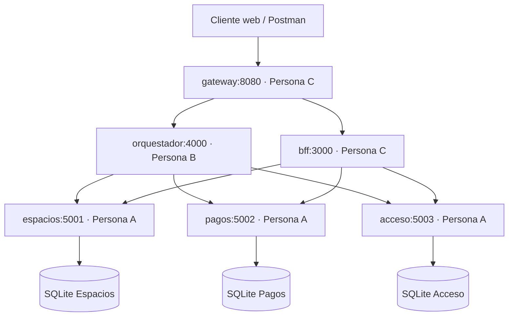

# CONTRATO COMÚN — Integración de Sistemas, Unidad 3 · Forma C

**Versión:** 1.1 — integración de las tres ramas (pendiente de aprobación del equipo)  
**Estado:** propuesta técnica lista para revisión del equipo; **no se presenta como aprobada por B y C**.  
**Documento base:** «Encargo Unidad 3 — Separación de responsabilidades (Forma C)», Paso 0 y tabla de endpoints.

## 1. Convenciones obligatorias

| Servicio | Responsable | Nombre DNS Docker | Puerto interno | ¿Publica puerto en Compose final? |
|---|---|---|---|---|
| API Gateway | C | `gateway` | `8080` | **Sí**, único publicado (en desarrollo `127.0.0.1:8080`) |
| BFF web | C | `bff` | `3000` | No |
| Orquestador Saga | B | `orquestador` | `4000` | No |
| Espacios | A | `espacios` | `5001` | No |
| Pagos | A | `pagos` | `5002` | No |
| Acceso | A | `acceso` | `5003` | No |

- **Todos los servicios se comunican por la red predeterminada de Docker Compose**, mediante `http://<nombre>:<puerto>`; `localhost` dentro de un contenedor se refiere a ese mismo contenedor, nunca a otro servicio.
- Archivo principal: `docker-compose.yml`; arranque previsto: `docker compose up --build` tras configurar `.env`. Los seis servicios están implementados.
- Bases independientes: A conserva una SQLite por microservicio y B agrega persistencia propia de las sagas (no reutilizar las bases de A).
- **Idempotencia:** `sagaId` se propaga a cada comando como identificador estable. La clave concreta en A es `(sagaId, accion)`, con huella del payload. Reenviar exactamente el mismo comando devuelve la **respuesta HTTP original** sin duplicar efectos; reutilizar el mismo `sagaId` para esa acción con payload diferente retorna `409 IDEMPOTENCY_KEY_REUSE`. Los comandos de compensación son también idempotentes. Tras compensar, la respuesta cacheada del comando previo puede seguir siendo `201`: el **estado vigente** se consulta con `GET`.
- **Autenticación central:** JWT firmado mediante **HS256**. `JWT_SECRET` se obtiene de un `.env` local, **solo lo valida gateway**; BFF/orquestador/dominio no lo revalidan porque no se exponen fuera de Docker. El gateway debe exigir `Authorization: Bearer <jwt>` para endpoints protegidos (responsable C); no deben registrarse tokens ni secretos.
- **Rate limiting** por cliente: implementado por C en Gateway. Gateway no contiene lógica de negocio.
- **Logs JSON**: una línea por evento, con campos obligatorios `timestamp`, `sagaId`, `servicio`, `paso`, `resultado`. `sagaId: null` se permite en eventos de salud/administración sin saga. Extras opcionales `codigo`, `idempotente`, `modo`, `duracionMs`.
- **Saga ORQUESTADA**: B controla el orden, compensa en orden inverso y registra cada transición. Se elige frente a coreografía para observar claramente la ruta de éxito y las compensaciones en demostración; se elige frente a 2PC porque Pagos/Acceso representan dependencias externas que no participan de un prepare/commit distribuido.

## 2. Diagrama de la dependencia

## 3. Contratos HTTP de Persona A — IMPLEMENTADOS

### 3.1 Espacios (`http://espacios:5001`)

| Método | Ruta | Entrada | Salida exitosa / error significativo |
|---|---|---|---|
| `POST` | `/reservas` | `{"sagaId":"s1","espacioId":"E-001"}` | `201 {"sagaId":"s1","espacioId":"E-001","estado":"RESERVADA"}`; `409 ESPACIO_OCUPADO`; `404 ESPACIO_NO_ENCONTRADO` |
| `POST` | `/reservas/{sagaId}/liberar` | Vacía | `200 {"sagaId":"s1","estado":"LIBERADA"}` o `SIN_RESERVA` |
| `GET` | `/espacios` | — | `200 {"espacios":[{"espacioId":"E-001","estado":"DISPONIBLE","sagaId":null},...]}` |
| `GET` | `/reservas/{sagaId}` | — | Reserva y estado vigente; `404` si no existe |
| `GET` | `/health` | — | Estado del servicio |

Catálogo de demostración: `E-001` a `E-010`. Reserva de un espacio ocupada por otra saga está prohibida; índice único parcial en SQLite asegura exclusión incluso con solicitudes concurrentes. Liberar después de haber reservado lo vuelve disponible. Se registran compensaciones anticipadas para evitar reservas tardías.

### 3.2 Pagos (`http://pagos:5002`)

| Método | Ruta | Entrada | Salida exitosa |
|---|---|---|---|
| `POST` | `/cobros` | `{"sagaId":"s1","monto":4000}` | `201 {"sagaId":"s1","monto":"4000","moneda":"CLP","estado":"COBRADO","referenciaPasarela":"SIM-s1"}` |
| `POST` | `/cobros/{sagaId}/reembolso` | Vacía | `200 {"sagaId":"s1","estado":"REEMBOLSADO"}` o `SIN_COBRO` |
| `GET` | `/cobros/{sagaId}` | — | Datos actuales y referencia del cobro; `404` si no existe |
| `GET` | `/health` | — | Estado del servicio |

`monto` es un número positivo, máximo dos decimales. Se guarda como entero en centavos de la **moneda simulada CLP**; `monto` de respuesta es texto decimal, no `float`. Cobro, referencia y reembolso son **simulados**, no transferencias bancarias reales. Nunca se reembolsa dos veces por reintentar el mismo `sagaId`.

### 3.3 Acceso (`http://acceso:5003`)

| Método | Ruta | Entrada | Salida exitosa / error |
|---|---|---|---|
| `POST` | `/habilitaciones` | `{"sagaId":"s1","patente":"ABCD12","espacioId":"E-001"}` | `201 {"sagaId":"s1","patente":"ABCD12","espacioId":"E-001","estado":"HABILITADA"}` |
| `POST` | `/habilitaciones/{sagaId}/revocar` | Vacía | `200 {"sagaId":"s1","estado":"REVOCADA"}` |
| `GET` | `/habilitaciones/{sagaId}` | — | Habilitación vigente; `404` si no existe; `502`/`503` según falla |
| `POST` | `/admin/falla` | `{"modo":"lento","delayMs":2500}` | `200 {"modo":"lento","delayMs":2500}` |
| `GET` | `/admin/falla` | — | Modo actual del simulador |
| `GET` | `/health` | — | Estado del microservicio y modo del controlador simulado |

Modos admitidos de `POST /admin/falla`: `ok`, `lento`, `caido`, `error`; `delayMs` entero de 0 a 30000. En `lento`, habilitar y consultar demoran `delayMs`; en `caido`, devuelven `503`; en `error`, devuelven `502`. Revocar **no requiere comunicación con el controlador simulado**: persiste una orden lógica de revocación incluso tras una falla o timeout, evitando habilitaciones tardías. Esto **no prueba revocación física** de una barrera real desconectada. La ruta `/admin/falla` es para pruebas internas: C debe excluirla del acceso público habitual.

### 3.4 Reglas de errores compartidas de A

- `422`: validación de cuerpo (FastAPI/Pydantic).
- `409` con `error: "IDEMPOTENCY_KEY_REUSE"`: mismos `sagaId` y acción, parámetros incompatibles.
- `409` con `error: "SAGA_COMPENSADA"`: el comando llegó después de su compensación preventiva.
- `409` con `error: "ESPACIO_OCUPADO"`: espacio reservado por otra saga.
- Una falla inducida en Acceso antes de confirmar habilitación **no crea un resultado exitoso almacenado**, por lo que un reintento legítimo podría funcionar al volver a `ok` si aún no se compensó.
- `POST` repetido exactamente igual responde **mismo código + mismo cuerpo**, incluso después de haber compensado. Los `GET` son la fuente del estado actual.

## 4. Contratos de Persona B — IMPLEMENTADOS (propuesta v1.1, pendiente de visto bueno de A y C)

**Orquestador:** `http://orquestador:4000` · código en `orquestador/` · pruebas en `orquestador/tests/`.

| Método | Ruta | Entrada | Respuesta |
|---|---|---|---|
| `POST` | `/reservas-estacionamiento` | `{"espacioId":"E-001","patente":"ABCD12","monto":4000}` (+ `sagaId` opcional) | `{"sagaId":"S-…","estado":"…","motivo":null}` |
| `GET` | `/reservas-estacionamiento/{sagaId}` | — | Saga completa: `sagaId, estado, espacioId, patente, monto, avance, motivo, creadoEn, actualizadoEn, transiciones[]`; `404 SAGA_NO_ENCONTRADA` |
| `GET` | `/metrics` | — | JSON con conteo de sagas por estado y, por dependencia: resultados, latencias (promedio/p50/p95/max), Circuit Breaker y Bulkhead |
| `GET` | `/health` | — | `{"servicio":"orquestador","estado":"ok","implementado":true,"circuitos":{…}}` |

**`sagaId` opcional:** si el cliente o el gateway lo envía (`^[A-Za-z0-9_-]{1,64}$`), repetir el POST devuelve la misma saga sin repetir efectos. Si no se envía, el orquestador genera `S-<uuid>`.

**Estados de la saga y código HTTP del POST:**

| Estado | Significado | HTTP |
|---|---|---|
| `COMPLETADA` | Reservado, cobrado y habilitado | `201` |
| `FALLIDA` | Rechazada sin efectos. Motivo de negocio (`ESPACIO_OCUPADO`, `ESPACIO_NO_ENCONTRADO`) | `409` |
| `FALLIDA` | Rechazo rápido sin tocar servicios porque hay un circuito abierto (`CIRCUITO_ABIERTO_<SERVICIO>`) | `503` |
| `COMPENSADA` | Falló un paso y se deshicieron los anteriores (`ACCESO_TIMEOUT`, `ACCESO_HTTP_5XX_502`, `BULKHEAD_LLENO_ACCESO`, …) | `503` |
| `COMPENSACION_PENDIENTE` | Alguna compensación no se pudo aplicar; se reintenta cada `RECUPERACION_INTERVALO_S` | `503` |
| `INICIADA`, `ESPACIO_RESERVADO`, `PAGO_COBRADO`, `COMPENSANDO` | Intermedios (visibles en GET) | `202` si se repite un `sagaId` en curso |

**Secuencia:** `POST espacios/reservas` → `POST pagos/cobros` → `POST acceso/habilitaciones`. El estado se persiste **antes** de cada llamada (columna `avance`).
**Compensación (orden inverso):** se deshace también el paso que falló por timeout/5xx, porque pudo haberse aplicado. Falla Acceso: revocar → reembolsar → liberar. Falla Pagos: reembolsar → liberar. Falla Espacios por timeout/5xx: liberar. Un 4xx significa que el paso no se aplicó y solo se compensan los anteriores.
**Recuperación:** al arrancar y periódicamente, las sagas en estado no final se compensan según su `avance` (las operaciones de A son idempotentes).

**Resiliencia (variables de entorno en `docker-compose.yml`):**

| Patrón | Dónde | Configuración por defecto |
|---|---|---|
| Timeout | Todas las llamadas a A | `TIMEOUT_S=2.0` |
| Circuit Breaker | Uno por servicio (espacios, pagos, acceso). Cuentan como fallo: timeout, error de conexión, 5xx. Un 4xx **no** cuenta | `CB_UMBRAL_FALLOS=3` fallos consecutivos → `ABIERTO`; tras `CB_ESPERA_S=10` → `SEMI_ABIERTO` (1 llamada de prueba) → `CERRADO` o `ABIERTO` |
| Fallback rápido | Con cualquier circuito abierto, el POST responde de inmediato `FALLIDA` sin reservar ni cobrar | — |
| Bulkhead | Llamadas de avance a Acceso. Sin cola: si está lleno, rechaza y compensa | `BULKHEAD_MAX=5` |
| Reintentos | Solo compensaciones (no pasan por CB ni bulkhead: siempre se intentan) | `COMPENSACION_REINTENTOS=3` |

**Persistencia propia:** SQLite `/data/orquestador.db` en volumen `orquestador_data` (tablas `sagas` y `transiciones`).

## 5. Contratos de Persona C — IMPLEMENTADOS (v1.0)

### 5.1 API Gateway (`http://gateway:8080`, publicado en `127.0.0.1:8080`)

| Método | Ruta pública | Autenticación | Destino / Comportamiento |
|---|---|---|---|
| `GET` | `/health` | Pública | `200 {"servicio":"gateway","estado":"ok","implementado":true,"jwtConfigurado":true}` |
| `POST` | `/auth/token` | Pública | Recibe `{"clienteId":"web-demo"}` y emite `200 {"access_token":"<jwt>","token_type":"Bearer","expires_in":7200}` (HS256) |
| `POST` | `/reservas-estacionamiento` | `Bearer <jwt>` | Proxy puro a `http://orquestador:4000/reservas-estacionamiento` |
| `GET` | `/reservas-estacionamiento/{sagaId}` | `Bearer <jwt>` | Proxy puro a `http://orquestador:4000/reservas-estacionamiento/{sagaId}` |
| `GET` | `/metrics` | `Bearer <jwt>` | Proxy puro a `http://orquestador:4000/metrics` |
| `GET` | `/bff/mi-reserva/{sagaId}` | `Bearer <jwt>` | Proxy puro a `http://bff:3000/bff/mi-reserva/{sagaId}` |
| `GET` | `/bff/dashboard` | `Bearer <jwt>` | Proxy puro a `http://bff:3000/bff/dashboard` |
| `ANY` | `*/admin/falla*` | Bloqueada | Rechazo explícito `403 {"error":"FORBIDDEN_ADMIN_ENDPOINT"}` antes de enrutar |

- **Errores de seguridad / control de tráfico en Gateway:**
  - `401 {"error":"TOKEN_FALTANTE_O_INVALIDO"}` / `TOKEN_INVALIDO` / `TOKEN_EXPIRADO`.
  - `429 {"error":"RATE_LIMIT_EXCEEDED","limitePorVentana":40}` (ventana deslizante de 60s por `sub` del JWT).
  - `502 {"error":"BAD_GATEWAY","detalle":"Servicio interno no disponible"}` si el servicio interno no responde.

### 5.2 BFF Web (`http://bff:3000`, interno en red Docker)

| Método | Ruta | Composición / Salida |
|---|---|---|
| `GET` | `/health` | `200 {"servicio":"bff","estado":"ok","implementado":true}` |
| `GET` | `/bff/mi-reserva/{sagaId}` | Consulta en paralelo (`asyncio.gather`) `orquestador`, `espacios`, `pagos` y `acceso` (timeout 1.2s). Devuelve `200 {"sagaId":...,"estadoGeneral":...,"motivo":...,"espacio":{...},"pago":{...},"acceso":{...},"degradacionActiva":bool}` o `404 RESERVA_NO_ENCONTRADA`. Si `acceso` falla o tarda >1.2s, degrada con `acceso: {"estado":"no_disponible","motivo":...}` y `degradacionActiva: true`. |
| `GET` | `/bff/dashboard` | Agrega catálogo (`espacios:5001/espacios`) + métricas (`orquestador:4000/metrics`): `200 {"espacios":[...],"metricasSistema":{...}}` (o `"no_disponible"` por bloque ante fallo). |

## 6. Matriz de responsabilidades (no duplicar patrones)

| Responsable A | Responsable B | Responsable C |
|---|---|---|
| Espacios, Pagos, Acceso | Orquestación Saga | Gateway/BFF |
| Bases de datos independientes de dominio | Base de datos propia de Saga | JWT HS256 y rate limit |
| Idempotencia local y compensaciones | Timeouts, Circuit Breaker, Bulkhead | Agregación y degradación elegante |
| Simulador `POST /admin/falla` | Estado/métricas de transacción | Escenarios de carga y evidencia |

## 7. Acuerdo pendiente del equipo (revisar antes de dar Paso 0 por firmado)

- [ ] A, B y C confirman nombres de contenedores, puertos y endpoints de este archivo.
- [x] B define la forma de `estado` en POST y GET del orquestador (§4); falta visto bueno de A y C.
- [x] C define las rutas públicas del Gateway, forma final del BFF y respuesta de autenticación/limitación (§5).
- [x] C confirma cómo bloqueará acceso público al endpoint de administración `/admin/falla` (HTTP 403 explícito en Gateway, §5.1).
- [ ] El equipo acuerda el formato de métricas (propuesta de B en §4) y el procedimiento de las pruebas de fallo.
- [ ] Una vez confirmado, fijar versión del contrato en Git y notificar a todos antes de modificar una interfaz.

> **Regla de integración:** si cambia una ruta, campo o estado, actualizar primero `CONTRATO.md`, después los consumidores. El scaffold se conserva únicamente como referencia histórica.
