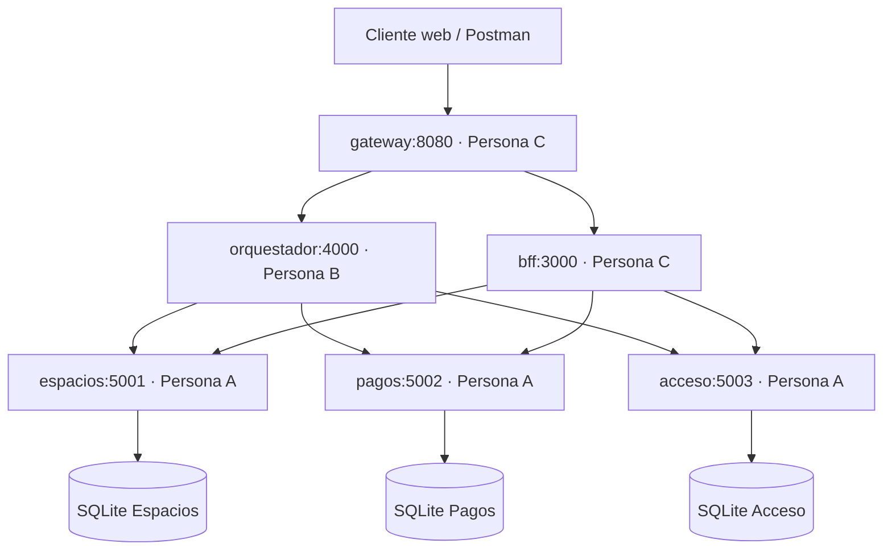

# CONTRATO COMÚN — Integración de Sistemas, Unidad 3 · Forma C

**Versión:** 1.0 — Paso 0 preparado el 20-11-2026  
**Estado:** propuesta técnica lista para revisión del equipo; **no se presenta como aprobada por B y C**.  
**Documento base:** «Encargo Unidad 3 — Separación de responsabilidades (Forma C)», Paso 0 y tabla de endpoints.

## 1. Convenciones obligatorias

| Servicio | Responsable | Nombre DNS Docker | Puerto interno | ¿Publica puerto en Compose final? |
|---|---|---|---|---|
| API Gateway | C | `gateway` | `8080` | **Sí**, único publicado (en desarrollo `127.0.0.1:8080`) |
| BFF web | C | `bff` | `3000` | No |
| Orquestador Saga | B | `orquestador` | `4000` | No |
| Espacios | A | `espacios` | `5001` | No |
| Pagos | A | `pagos` | `5002` | No |
| Acceso | A | `acceso` | `5003` | No |

- **Todos los servicios se comunican por la red predeterminada de Docker Compose**, mediante `http://<nombre>:<puerto>`; `localhost` dentro de un contenedor se refiere a ese mismo contenedor, nunca a otro servicio.
- Archivo principal: `docker-compose.yml`; arranque previsto: `docker compose up --build` (una vez que B y C reemplacen sus stubs, el sistema completo podrá operar). Por ahora los tres servicios de A son funcionales, y gateway/BFF/orquestador son placeholders que devuelven HTTP 501 en rutas de negocio.
- Bases independientes: A conserva una SQLite por microservicio y B tendrá que agregar persistencia propia de las sagas (no reutilizar las bases de A).
- **Idempotencia:** `sagaId` se propaga a cada comando como identificador estable. La clave concreta en A es `(sagaId, accion)`, con huella del payload. Reenviar exactamente el mismo comando devuelve la **respuesta HTTP original** sin duplicar efectos; reutilizar el mismo `sagaId` para esa acción con payload diferente retorna `409 IDEMPOTENCY_KEY_REUSE`. Los comandos de compensación son también idempotentes. Tras compensar, la respuesta cacheada del comando previo puede seguir siendo `201`: el **estado vigente** se consulta con `GET`.
- **Autenticación central:** JWT firmado mediante **HS256**. `JWT_SECRET` se obtiene de un `.env` local, **solo lo valida gateway**; BFF/orquestador/dominio no lo revalidan porque no se exponen fuera de Docker. El gateway debe exigir `Authorization: Bearer <jwt>` para endpoints protegidos (responsable C); no deben registrarse tokens ni secretos.
- **Rate limiting** por cliente: implementado por C en Gateway. Gateway no contiene lógica de negocio.
- **Logs JSON**: una línea por evento, con campos obligatorios `timestamp`, `sagaId`, `servicio`, `paso`, `resultado`. `sagaId: null` se permite en eventos de salud/administración sin saga. Extras opcionales `codigo`, `idempotente`, `modo`, `duracionMs`.
- **Saga ORQUESTADA**: B controla el orden, compensa en orden inverso y registra cada transición. Se elige frente a coreografía para observar claramente la ruta de éxito y las compensaciones en demostración; se elige frente a 2PC porque Pagos/Acceso representan dependencias externas que no participan de un prepare/commit distribuido.

## 2. Diagrama de la dependencia

## 3. Contratos HTTP de Persona A — IMPLEMENTADOS

### 3.1 Espacios (`http://espacios:5001`)

| Método | Ruta | Entrada | Salida exitosa / error significativo |
|---|---|---|---|
| `POST` | `/reservas` | `{"sagaId":"s1","espacioId":"E-001"}` | `201 {"sagaId":"s1","espacioId":"E-001","estado":"RESERVADA"}`; `409 ESPACIO_OCUPADO`; `404 ESPACIO_NO_ENCONTRADO` |
| `POST` | `/reservas/{sagaId}/liberar` | Vacía | `200 {"sagaId":"s1","estado":"LIBERADA"}` o `SIN_RESERVA` |
| `GET` | `/espacios` | — | `200 {"espacios":[{"espacioId":"E-001","estado":"DISPONIBLE","sagaId":null},...]}` |
| `GET` | `/reservas/{sagaId}` | — | Reserva y estado vigente; `404` si no existe |
| `GET` | `/health` | — | Estado del servicio |

Catálogo de demostración: `E-001` a `E-010`. Reserva de un espacio ocupada por otra saga está prohibida; índice único parcial en SQLite asegura exclusión incluso con solicitudes concurrentes. Liberar después de haber reservado lo vuelve disponible. Se registran compensaciones anticipadas para evitar reservas tardías.

### 3.2 Pagos (`http://pagos:5002`)

| Método | Ruta | Entrada | Salida exitosa |
|---|---|---|---|
| `POST` | `/cobros` | `{"sagaId":"s1","monto":4000}` | `201 {"sagaId":"s1","monto":"4000","moneda":"CLP","estado":"COBRADO","referenciaPasarela":"SIM-s1"}` |
| `POST` | `/cobros/{sagaId}/reembolso` | Vacía | `200 {"sagaId":"s1","estado":"REEMBOLSADO"}` o `SIN_COBRO` |
| `GET` | `/cobros/{sagaId}` | — | Datos actuales y referencia del cobro; `404` si no existe |
| `GET` | `/health` | — | Estado del servicio |

`monto` es un número positivo, máximo dos decimales. Se guarda como entero en centavos de la **moneda simulada CLP**; `monto` de respuesta es texto decimal, no `float`. Cobro, referencia y reembolso son **simulados**, no transferencias bancarias reales. Nunca se reembolsa dos veces por reintentar el mismo `sagaId`.

### 3.3 Acceso (`http://acceso:5003`)

| Método | Ruta | Entrada | Salida exitosa / error |
|---|---|---|---|
| `POST` | `/habilitaciones` | `{"sagaId":"s1","patente":"ABCD12","espacioId":"E-001"}` | `201 {"sagaId":"s1","patente":"ABCD12","espacioId":"E-001","estado":"HABILITADA"}` |
| `POST` | `/habilitaciones/{sagaId}/revocar` | Vacía | `200 {"sagaId":"s1","estado":"REVOCADA"}` |
| `GET` | `/habilitaciones/{sagaId}` | — | Habilitación vigente; `404` si no existe; `502`/`503` según falla |
| `POST` | `/admin/falla` | `{"modo":"lento","delayMs":2500}` | `200 {"modo":"lento","delayMs":2500}` |
| `GET` | `/admin/falla` | — | Modo actual del simulador |
| `GET` | `/health` | — | Estado del microservicio y modo del controlador simulado |

Modos admitidos de `POST /admin/falla`: `ok`, `lento`, `caido`, `error`; `delayMs` entero de 0 a 30000. En `lento`, habilitar y consultar demoran `delayMs`; en `caido`, devuelven `503`; en `error`, devuelven `502`. Revocar **no requiere comunicación con el controlador simulado**: persiste una orden lógica de revocación incluso tras una falla o timeout, evitando habilitaciones tardías. Esto **no prueba revocación física** de una barrera real desconectada. La ruta `/admin/falla` es para pruebas internas: C debe excluirla del acceso público habitual.

### 3.4 Reglas de errores compartidas de A

- `422`: validación de cuerpo (FastAPI/Pydantic).
- `409` con `error: "IDEMPOTENCY_KEY_REUSE"`: mismos `sagaId` y acción, parámetros incompatibles.
- `409` con `error: "SAGA_COMPENSADA"`: el comando llegó después de su compensación preventiva.
- `409` con `error: "ESPACIO_OCUPADO"`: espacio reservado por otra saga.
- Una falla inducida en Acceso antes de confirmar habilitación **no crea un resultado exitoso almacenado**, por lo que un reintento legítimo podría funcionar al volver a `ok` si aún no se compensó.
- `POST` repetido exactamente igual responde **mismo código + mismo cuerpo**, incluso después de haber compensado. Los `GET` son la fuente del estado actual.

## 4. Contratos de Persona B — PENDIENTES DE IMPLEMENTACIÓN

**Orquestador:** `http://orquestador:4000`

| Método | Ruta | Entrada | Respuesta mínima |
|---|---|---|---|
| `POST` | `/reservas-estacionamiento` | `{"espacioId":"E-001","patente":"ABCD12","monto":4000}` | `{"sagaId":"<id>","estado":"<estado>"}` |
| `GET` | `/reservas-estacionamiento/{sagaId}` | — | Estado de la saga persistido por B; **forma exacta por concretar con B** |
| `GET` | `/metrics` | — | Métricas observables de CB, bulkhead, latencias y sagas; **formato por concretar con B** |

Secuencia éxito: `POST espacios/reservas` → `POST pagos/cobros` → `POST acceso/habilitaciones`. Tras fallo en último paso: `POST acceso/habilitaciones/{sagaId}/revocar` (preventiva) → `POST pagos/cobros/{sagaId}/reembolso` → `POST espacios/reservas/{sagaId}/liberar`. Si el paso 2 falla, solo se libera el espacio. Timeout en todas las llamadas; Circuit Breaker con fallback rápido y Bulkhead sobre Acceso. La Saga guarda su estado en almacenamiento propio.

**Propuesta por validar con B antes de integrar:** representar estados finales como `COMPLETADA` y `COMPENSADA`, y los estados intermedios que B elija. El documento original solo exige `{sagaId, estado}`, no impone vocabulario de valores.

## 5. Contratos de Persona C — PENDIENTES DE IMPLEMENTACIÓN

- **Gateway**, puerto `8080`: único acceso externo. Valida JWT HS256, aplica rate limiting por cliente y enruta al orquestador y al BFF; sin lógica de negocio. **Las rutas públicas exactas deberán confirmarse con C**; se recomienda conservar las rutas internas para simplificar pruebas.
- **BFF**, puerto `3000`: `GET /bff/mi-reserva/{sagaId}`. Debe componer en **una sola respuesta** la información de al menos dos servicios; se recomienda Espacios, Pagos y Acceso. Ante timeout/502/503 de Acceso, responder igual con datos existentes y marcar la sección de acceso como `no_disponible` (nombre del campo y estructura final por concretar con C).
- Solo se habilita `GET /health` en los placeholders actuales; las rutas de negocio responden `501 PENDIENTE_IMPLEMENTACION`. **Un contenedor healthy no significa que el módulo de B/C ya esté listo.**

## 6. Matriz de responsabilidades (no duplicar patrones)

| Responsable A | Responsable B | Responsable C |
|---|---|---|
| Espacios, Pagos, Acceso | Orquestación Saga | Gateway/BFF |
| Bases de datos independientes de dominio | Base de datos propia de Saga | JWT HS256 y rate limit |
| Idempotencia local y compensaciones | Timeouts, Circuit Breaker, Bulkhead | Agregación y degradación elegante |
| Simulador `POST /admin/falla` | Estado/métricas de transacción | Escenarios de carga y evidencia |

## 7. Acuerdo pendiente del equipo (revisar antes de dar Paso 0 por firmado)

- [ ] A, B y C confirman nombres de contenedores, puertos y endpoints de este archivo.
- [ ] B valida la forma de `estado` en POST y GET del orquestador, incluido manejo de saga fallida.
- [ ] C define las rutas públicas del Gateway, forma final del BFF y respuesta de autenticación/limitación.
- [ ] C confirma cómo bloqueará acceso público al endpoint de administración `/admin/falla`.
- [ ] El equipo acuerda el formato de métricas y el procedimiento de las pruebas de fallo.
- [ ] Una vez confirmado, fijar versión del contrato en Git y notificar a todos antes de modificar una interfaz.

> **Regla de integración:** si cambia una ruta, campo o estado, actualizar primero `CONTRATO.md`, después los consumidores. No se debe atribuir implementación a B/C por el solo hecho de incluir sus stubs.
