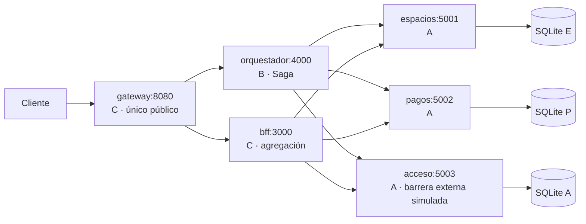
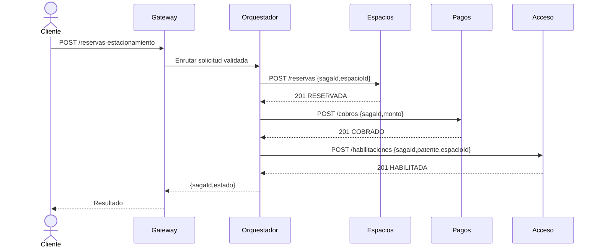
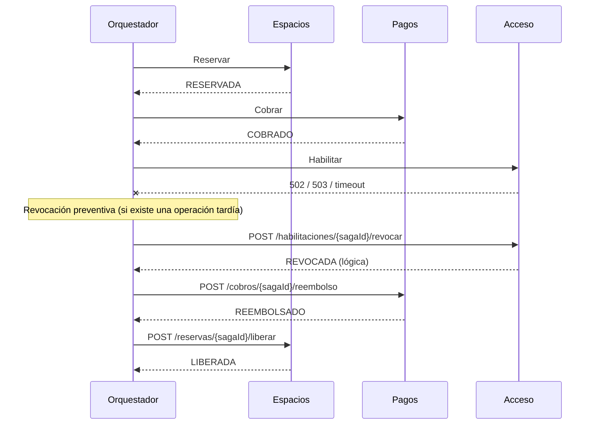

# Diagramas de arquitectura — Paso 0 (Forma C)

## Entrada, dependencias y persistencia

*Las conexiones son el **diseño objetivo**. En el Compose de Paso 0, gateway/BFF/orquestador son stubs y todavía no ejecutan esas llamadas.*

## Camino feliz (responsable de la secuencia: B)

## Falla en la última dependencia con compensación inversa

**Limitación:** son diagramas del comportamiento esperado una vez integrado el equipo. Los servicios de A implementan las operaciones; el flujo automático de Saga y los patrones CB/Bulkhead corresponden a B.
