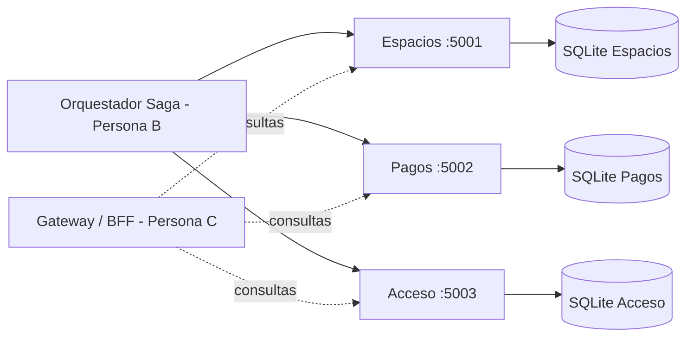
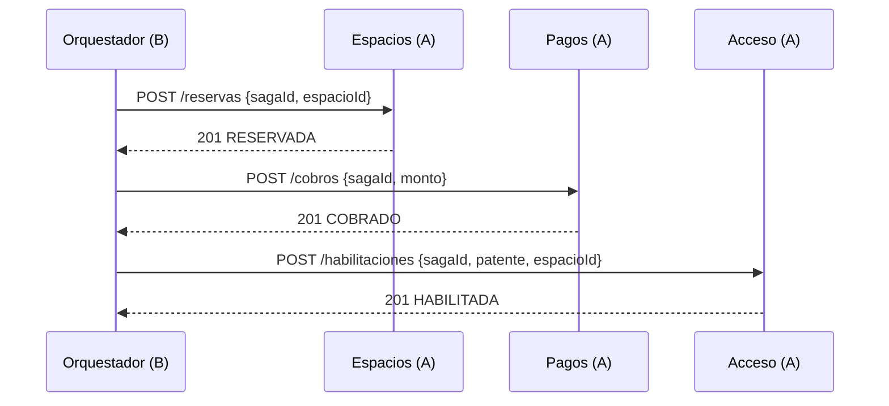
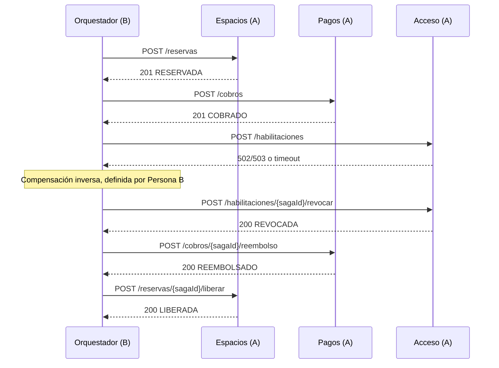
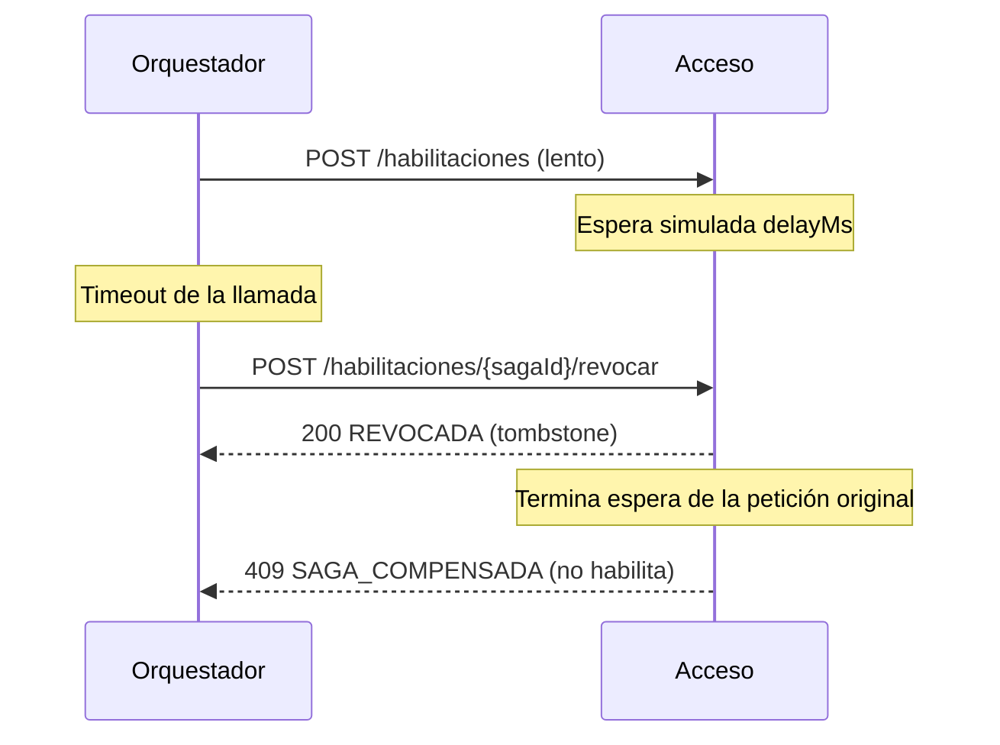

# Diagramas de Persona A para informe / defensa

## Contexto de servicios y bases de datos

El orquestador controla la secuencia; cada microservicio conserva su estado local. No existe una transacción ACID global entre ellos.

## Camino feliz (secuencia de las llamadas que recibirá A)

## Error inducido en la barrera y compensaciones

## Cómo la idempotencia detiene efectos tardíos

Nota: con una barrera real que pudiera habilitar después de una caída, habría que reconciliar estados y confirmar revocaciones remotas; el ejemplo garantiza coherencia dentro del simulador.
